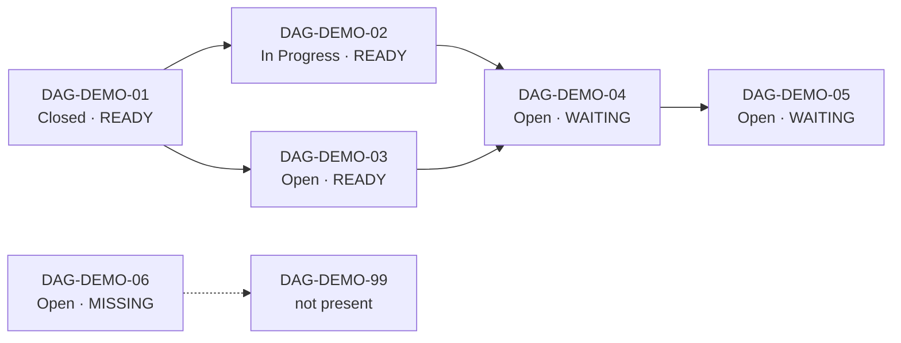

# Dependency DAG demo

Run the board from the repository root:

```sh
cargo run -- --root examples/dag-demo
```

Press `Tab` three times to open the DAG view, then press `C` to show the
completed root ticket. Select `DAG-DEMO-04` to see its two prerequisites marked
with `←` and its downstream ticket marked with `→`. Select `DAG-DEMO-06` to see
how a missing dependency is reported.

The example graph has a branch, a join, a completed prerequisite, an in-progress
ticket, and one intentionally unresolved dependency:


